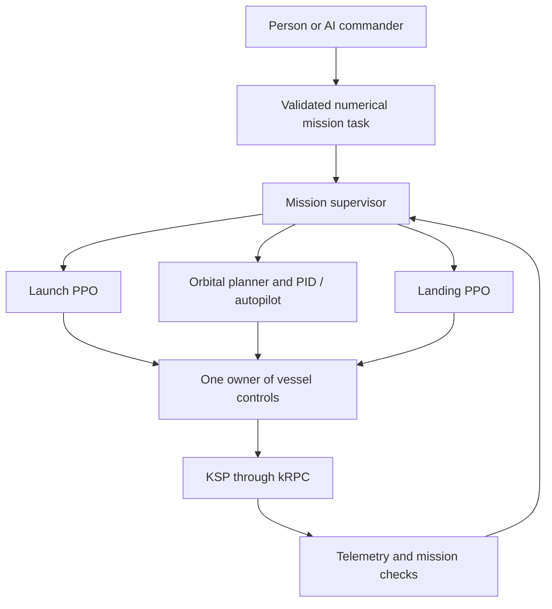

# Orbit: autonomous KSP mission control

Build a flight system that accepts a mission from a person or an AI commander,
launches a rocket into orbit, changes that orbit, and lands using engine thrust.

> **Model availability:** This repository currently contains training scripts and
> supporting source code only; pretrained model weights are not included. Model
> weights will be uploaded after the intended training goals have been achieved
> and verified through evaluation.

The first vehicle profile is a single rocket on stock Kerbin, launching eastward
into an 80–180 km apoapsis orbit. Powered landing will start with a throttleable
engine and prepared descent states. Other bodies, arbitrary inclinations,
detached-booster recovery, and full atmospheric return are later extensions.

## Architecture



There are three control stages, initially using two PPO policies and a
deterministic orbital controller. A third PPO policy is optional future research.
The commander chooses goals; the flight controllers choose flight actions.

## Implementation status

| Component | Current state |
| --- | --- |
| Structured mission commands | Implemented, with offline validation and examples |
| Mission supervisor | Implemented coordination core with simulated test doubles; no live adapter yet |
| Launch PPO environment | Existing kRPC environment, with command validation and terminal cutoff fixes; flight validation and retraining required |
| Apoapsis PPO experiment | Raising-only specialist, consolidated into one implementation; not the planned orbital controller |
| Orbital maneuver planner / PID | Planned |
| Landing environment and PPO | Planned |
| AI commander | Planned; a person can already write the same JSON command format |
| Complete launch–maneuver–land mission | Planned |

No trained policies, KSP craft files, or training saves are included. Offline
tests do not measure flight performance. The supervisor does not yet run the
legacy training environments or fly a vessel.

## Try the commander interface without KSP

Use Python 3.10 or newer. Run these commands from the repository root. The
mission package and tests use only the Python standard library.

```powershell
python -m mission_control validate examples/reach_orbit.json
python -m mission_control validate examples/change_orbit.json
python -m mission_control validate examples/land.json
python -m mission_control validate examples/reach_orbit.json --launch-options
python -m unittest discover -s tests -v
```

`validate` checks the schema and the first profile's numerical limits. It does
not check vehicle performance, fuel feasibility, policy availability, or whether
KSP is running. Invalid commands exit with code 2. Nothing connects to KSP.

Example mission:

```json
{
  "schema_version": 1,
  "task_id": "launch-001",
  "task": "reach_orbit",
  "body": "Kerbin",
  "target": {
    "apoapsis_m": 120000,
    "periapsis_m": 100000
  },
  "minimum_fuel_fraction": 0.02,
  "urgency": 0.5,
  "timeout_s": 900,
  "settle_time_s": 3
}
```

Unknown fields, non-finite numbers, unsupported bodies, and out-of-range goals
are rejected. Constraints are never silently reduced. Fuel fraction is a
prototype measure relative to the starting load, not a delta-v guarantee.

The orbit targets currently describe apoapsis/periapsis altitudes above sea
level, not distances from the planet's center. Landing targets use degrees and
meters. See [the architecture contract](docs/architecture.md) for telemetry,
controller ownership, and handoff requirements.

## Run flight training when KSP is ready

Create an isolated environment and install the optional flight dependencies:

```powershell
python -m venv .venv
.\.venv\Scripts\python.exe -m pip install -e ".[training]"
```

The commands below assume the environment is activated, KSP is running, and the
kRPC server is installed and enabled. Do not run flight commands as offline
tests: environment resets load KSP saves and may launch or stage the vessel.

The training dependencies pin the Python kRPC client to **0.6.0**, matching the
installed KSP mod. Keep the in-game mod and Python client on the same release.
The 0.7 client uses a newer protocol and cannot connect to the 0.6 server.

### Launch policy

Prepare a named save, `launchpad_ready`, containing the correctly staged rocket
on the pad. The current script uses a 16-value observation and two actions in
`[0, 1]`: throttle and pitch fraction. Heading is fixed eastward; staging and
attitude stabilization use scripted helpers and KSP autopilot.

Check the environment before a long run:

```powershell
python -m scripts.check_launch
python -m scripts.orbit_command
```

Launch training currently reads settings from `scripts/orbit_command.py`.
It resumes `ppo_ksp_commanded_pilot_v4.zip` if present; otherwise it starts fresh.
Periodic checkpoints go into `models_v4/`. Completion and Ctrl+C save the main
model and `_latest` model. To resume a periodic checkpoint, copy the chosen
checkpoint to the main model filename before starting. Keep the original.

Evaluate a selected checkpoint:

```powershell
python -m scripts.test_orbit --model ppo_ksp_commanded_pilot_v4.zip
```

This runs six deterministic target-orbit cases from the same launch save.
It is a smoke evaluation, not a robust estimate of generalization.

`env.reset(options=task.launch_options())` selects a goal and reloads a training
save. `env.set_command(task.launch_options())` changes the current environment's
goal without loading a save or staging. The latter is a command update API,
not a complete deployment runner. Do not run this environment concurrently with
the mission supervisor: it writes directly to KSP controls.

Tighter orbit tolerances can be requested, but the existing training curriculum
uses 10 km tolerances. A policy's accuracy must be measured before claiming it
can satisfy tighter requests.

### Legacy apoapsis specialist

Prepare `orbit_training_start` in a stable Kerbin orbit with a usable engine and
prograde SAS. Settings live in `scripts/apoapsis_brain.py`.

```powershell
python -m scripts.apoapsis_brain check
python -m scripts.apoapsis_brain train --timesteps 250000
python -m scripts.apoapsis_brain train --resume apoapsis_specialist_output/checkpoints/apoapsis_specialist_25000_steps.zip --timesteps 250000
python -m scripts.apoapsis_brain evaluate
```

`--timesteps` specifies additional training steps. Evaluation uses
`MODEL_TO_EVALUATE` in the settings. `scripts/apoapsis_specialist.py` remains a
compatibility entry point for the same implementation. This experiment only
raises apoapsis; it does not implement arbitrary maneuvers or deorbit burns.

## Milestones and evidence

1. **Commander and supervisor foundation:** strict commands, exclusive control,
   abort/failure handling, and offline regression tests. Implemented core;
   live integration remains.
2. **Reliable launch:** install kRPC, validate resets and physics timing, add a
   scripted baseline and a live launch adapter, retrain, then evaluate held-out
   targets and starting conditions. Verify orbit and reserve with engines off.
3. **Orbital maneuvers:** plan and execute apoapsis/periapsis changes, compare
   accuracy and propellant use with the PPO specialist, and add deorbit planning.
4. **Powered landing:** begin with low-altitude vertical descents, then introduce
   horizontal velocity, target location, mass, and thrust variation. Train on
   states produced by the preceding controller before connecting the stages.
5. **Complete missions:** connect validated handoffs, add natural-language task
   translation, and publish reproducible results and failure examples.

Record success counts, orbit errors, fuel remaining, touchdown speeds, landing
distance, interventions, and failure reasons. Compare learned policies with
simple scripted/PID baselines on the same conditions. Keep evaluation conditions
separate from training. A complete mission needs its own success rate in addition
to each controller's results.

## Keep training recoverable

Model `.zip` files and generated training outputs are intentionally ignored by
Git. A source-code push does **not** back them up. Store selected checkpoints in
an off-machine backup or an artifact release before reinstalling an OS.

Keep the checkpoint together with the Git commit, Python/package versions,
training settings and seed, KSP/kRPC/mod versions, craft, training saves, and
evaluation report. If observation normalization is added, retain its statistics
too. Capture the installed training environment after setup:

```powershell
python -m pip freeze > requirements-training.lock.txt
```

The repository declares dependencies but does not yet contain a flight-validated
dependency lock. Checkpoint continuation is supported; exact reproduction of
the interrupted simulator trajectory is not guaranteed.

## Repository map

- `mission_control/`: dependency-free tasks, validation CLI, and supervisor core.
- `examples/`: mission JSON for each planned control stage.
- `scripts/orbit_command.py`: existing launch training environment and PPO runner.
- `scripts/test_orbit.py`: deterministic launch evaluation.
- `scripts/apoapsis_brain.py`: canonical legacy apoapsis experiment.
- `tests/`: offline contract, supervisor, and training regression tests.
- `data_train/`: existing flight recordings; not PPO checkpoints and not consumed
  by the current on-policy training scripts.
- [Launch training design notes](docs/launch-training-design.md): original
  curriculum and reward-design reference, with illustrative configurations.
