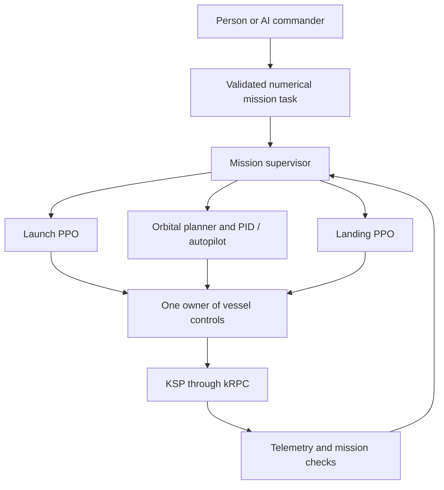

# Orbit: autonomous KSP mission control

Build a flight system that accepts a mission from a person or an AI commander,
launches a rocket into orbit, changes that orbit, and lands using engine thrust.

> **First model weights available:** The experimental launch PPO checkpoint is
> available in [launch-v0.1.0](https://github.com/JOk3r01001/Orbit/releases/tag/launch-v0.1.0),
> trained for **1,025,855 steps** with reward revision **2**. The release includes
> the model, SHA-256 checksums, dependency versions, and a model card. Further
> controller weights will be published as their training goals are achieved.

The first vehicle profile is a single rocket on stock Kerbin, launching eastward
into an 80–180 km apoapsis orbit. Powered landing will start with a throttleable
engine and prepared descent states. Other bodies, arbitrary inclinations,
detached-booster recovery, and full atmospheric return are later extensions.

## Architecture



There are three control stages, initially using two PPO policies and a
deterministic orbital controller. A third PPO policy is optional future research.
The commander chooses goals; the flight controllers choose flight actions.

## Implementation status

| Component | Current state |
| --- | --- |
| Structured mission commands | Implemented, with offline validation and examples |
| Mission supervisor | Implemented coordination core with simulated test doubles; no live adapter yet |
| Launch PPO environment | First experimental weights released; reported deterministic evaluation passed 6/6 reference-vessel missions |
| Apoapsis PPO experiment | Raising-only specialist, consolidated into one implementation; not the planned orbital controller |
| Orbital maneuver planner / PID | Planned |
| Landing environment and PPO | Planned |
| AI commander | Planned; a person can already write the same JSON command format |
| Complete launch–maneuver–land mission | Planned |

Launch model weights are distributed as GitHub release assets, separately from
the source tree. KSP craft files and training saves are not included. Offline
tests do not measure flight performance. The supervisor does not yet run the
legacy training environments or fly a vessel.

## First launch model release

Download [ppo_ksp_commanded_pilot_v4.zip](https://github.com/JOk3r01001/Orbit/releases/download/launch-v0.1.0/ppo_ksp_commanded_pilot_v4.zip)
from the [first experimental launch release](https://github.com/JOk3r01001/Orbit/releases/tag/launch-v0.1.0).
The [model card](models/launch-v0.1.0/model-card.md) describes the checkpoint,
control interface, environment, limitations, and evaluation provenance.

| Reported deterministic launch evaluation | Result |
| --- | --- |
| Fixed target-orbit cases | 6 |
| Successful cases | 6/6 |
| Mean absolute apoapsis error | 4.0 km |
| Mean absolute periapsis error | 9.8 km |
| Mean fuel-fraction margin above the requirement | +0.102 |

These are user-reported results from `scripts/test_orbit.py` on one reference
vessel and starting save, with 10 km orbital tolerances. They establish a working
launch prototype, not general reliability across vessels or conditions. The
original evaluation did not record a checkpoint hash; the released file is the
latest saved checkpoint and was not separately flight-tested during packaging.

After installing the training dependencies and preparing a compatible vessel,
the `launchpad_ready` save, and a running kRPC 0.6.0 server, evaluate a downloaded
checkpoint with:

```powershell
python -m scripts.test_orbit --model path\to\ppo_ksp_commanded_pilot_v4.zip
```

To resume training, place the downloaded model at the repository root with its
original filename, preserving a backup of any existing model, then run
`python -m scripts.orbit_command`. A compatible craft and save are required;
changing the vessel may require evaluation and fine-tuning. Staging remains
scripted. Orbital-maneuver and landing weights are not yet available.

## Try the commander interface without KSP

Use Python 3.10 or newer. Run these commands from the repository root. The
mission package and tests use only the Python standard library.

```powershell
python -m mission_control validate examples/reach_orbit.json
python -m mission_control validate examples/change_orbit.json
python -m mission_control validate examples/land.json
python -m mission_control validate examples/reach_orbit.json --launch-options
python -m unittest discover -s tests -v
```

`validate` checks the schema and the first profile's numerical limits. It does
not check vehicle performance, fuel feasibility, policy availability, or whether
KSP is running. Invalid commands exit with code 2. Nothing connects to KSP.

Example mission:

```json
{
  "schema_version": 1,
  "task_id": "launch-001",
  "task": "reach_orbit",
  "body": "Kerbin",
  "target": {
    "apoapsis_m": 120000,
    "periapsis_m": 100000
  },
  "minimum_fuel_fraction": 0.02,
  "urgency": 0.5,
  "timeout_s": 900,
  "settle_time_s": 3
}
```

Unknown fields, non-finite numbers, unsupported bodies, and out-of-range goals
are rejected. Constraints are never silently reduced. Fuel fraction is a
prototype measure relative to the starting load, not a delta-v guarantee.

The orbit targets currently describe apoapsis/periapsis altitudes above sea
level, not distances from the planet's center. Landing targets use degrees and
meters. See [the architecture contract](docs/architecture.md) for telemetry,
controller ownership, and handoff requirements.

## Run flight training when KSP is ready

Create an isolated environment and install the optional flight dependencies:

```powershell
python -m venv .venv
.\.venv\Scripts\python.exe -m pip install -e ".[training]"
```

The commands below assume the environment is activated, KSP is running, and the
kRPC server is installed and enabled. Do not run flight commands as offline
tests: environment resets load KSP saves and may launch or stage the vessel.

The training dependencies pin the Python kRPC client to **0.6.0**, matching the
installed KSP mod. Keep the in-game mod and Python client on the same release.
The 0.7 client uses a newer protocol and cannot connect to the 0.6 server.

### Launch policy

Prepare a named save, `launchpad_ready`, containing the correctly staged rocket
on the pad. The current script uses a 16-value observation and two actions in
`[0, 1]`: throttle and pitch fraction. Heading is fixed eastward; staging and
attitude stabilization use scripted helpers and KSP autopilot.

Check the environment before a long run:

```powershell
python -m scripts.check_launch
python -m scripts.orbit_command
```

Launch training currently reads settings from `scripts/orbit_command.py`.
It resumes `ppo_ksp_commanded_pilot_v4.zip` if present; otherwise it starts fresh.
Periodic checkpoints go into `models_v4/`. Completion and Ctrl+C save the main
model and `_latest` model. To resume a periodic checkpoint, copy the chosen
checkpoint to the main model filename before starting. Keep the original.

Evaluate a selected checkpoint:

```powershell
python -m scripts.test_orbit --model ppo_ksp_commanded_pilot_v4.zip
```

This runs six deterministic target-orbit cases from the same launch save.
It is a smoke evaluation, not a robust estimate of generalization.

Monitor training with `tensorboard --logdir .\ksp_tensorboard_v4`. In addition
to the rolling reward and success rate, `episodes/success_return` and
`episodes/failure_return` separate completed-flight returns by outcome. These
two metrics average the episodes completed since the last logging update.
`reward_step/*` reports average per-step reward components, while
`reward_episode/*` reports component totals for completed episodes. Episode
summaries also print the full return. These diagnostics require restarting the
training process to load the updated code; existing model weights are preserved.

The completion throttle cutoff requires periapsis to be above 70 km, even when
a low requested periapsis and its tolerance would otherwise permit an orbit
inside the atmosphere. Burn assistance and its reward guidance use the same
safety boundary.

Reward revision **2** removes the recurring apoapsis-deficit charge: closing the
orbital error still earns progress reward, moving away still loses reward, and
time still has a cost. Throttle and pitch intervention coefficients are reduced
from 0.10 to 0.01 each; all flight-control guards remain active. Coasting alone
earns no standing bonus, and positive burn guidance is proportional to measured
periapsis progress, so unchanged trajectories cannot earn those recurring bonuses.

Revision 2 resumes the same model files and preserves the observation/action
format, curriculum counter, and PPO hyperparameters. It writes a separate
`PPO_reward_v2_*` run under `ksp_tensorboard_v4/` and records the revision and
reward configuration in newly saved model metadata. Higher rewards after this
change do not establish better flight performance; compare success rates, orbit
errors, and fuel use. Initial rolling episode averages can include earlier
episodes retained in the resumed checkpoint. The new code takes effect after a
normal Ctrl+C save and restart of training.

`env.reset(options=task.launch_options())` selects a goal and reloads a training
save. `env.set_command(task.launch_options())` changes the current environment's
goal without loading a save or staging. The latter is a command update API,
not a complete deployment runner. Do not run this environment concurrently with
the mission supervisor: it writes directly to KSP controls.

Tighter orbit tolerances can be requested, but the existing training curriculum
uses 10 km tolerances. A policy's accuracy must be measured before claiming it
can satisfy tighter requests.

### Legacy apoapsis specialist

Prepare `orbit_training_start` in a stable Kerbin orbit with a usable engine and
prograde SAS. Settings live in `scripts/apoapsis_brain.py`.

```powershell
python -m scripts.apoapsis_brain check
python -m scripts.apoapsis_brain train --timesteps 250000
python -m scripts.apoapsis_brain train --resume apoapsis_specialist_output/checkpoints/apoapsis_specialist_25000_steps.zip --timesteps 250000
python -m scripts.apoapsis_brain evaluate
```

`--timesteps` specifies additional training steps. Evaluation uses
`MODEL_TO_EVALUATE` in the settings. `scripts/apoapsis_specialist.py` remains a
compatibility entry point for the same implementation. This experiment only
raises apoapsis; it does not implement arbitrary maneuvers or deorbit burns.

## Milestones and evidence

1. **Commander and supervisor foundation:** strict commands, exclusive control,
   abort/failure handling, and offline regression tests. Implemented core;
   live integration remains.
2. **Reliable launch:** first experimental checkpoint published after a reported
   6/6 deterministic reference-vessel evaluation. Broader held-out evaluation,
   physics-time stepping, a scripted baseline, and the live supervisor adapter
   remain to be completed. Verify orbit and reserve with engines off.
3. **Orbital maneuvers:** plan and execute apoapsis/periapsis changes, compare
   accuracy and propellant use with the PPO specialist, and add deorbit planning.
4. **Powered landing:** begin with low-altitude vertical descents, then introduce
   horizontal velocity, target location, mass, and thrust variation. Train on
   states produced by the preceding controller before connecting the stages.
5. **Complete missions:** connect validated handoffs, add natural-language task
   translation, and publish reproducible results and failure examples.

Record success counts, orbit errors, fuel remaining, touchdown speeds, landing
distance, interventions, and failure reasons. Compare learned policies with
simple scripted/PID baselines on the same conditions. Keep evaluation conditions
separate from training. A complete mission needs its own success rate in addition
to each controller's results.

## Keep training recoverable

Local model `.zip` files and generated training outputs are intentionally ignored
by Git. A source-code push does **not** back them up. Published checkpoints are
uploaded separately as GitHub release assets; the first is
[launch-v0.1.0](https://github.com/JOk3r01001/Orbit/releases/tag/launch-v0.1.0).
Back up newer unpublished checkpoints off-machine before reinstalling an OS.

Keep the checkpoint together with the Git commit, Python/package versions,
training settings and seed, KSP/kRPC/mod versions, craft, training saves, and
evaluation report. If observation normalization is added, retain its statistics
too. Capture the installed training environment after setup:

```powershell
python -m pip freeze > requirements-training.lock.txt
```

The repository declares dependencies but does not yet contain a flight-validated
dependency lock. Checkpoint continuation is supported; exact reproduction of
the interrupted simulator trajectory is not guaranteed.

## Repository map

- `mission_control/`: dependency-free tasks, validation CLI, and supervisor core.
- `examples/`: mission JSON for each planned control stage.
- `scripts/orbit_command.py`: existing launch training environment and PPO runner.
- `scripts/test_orbit.py`: deterministic launch evaluation.
- `scripts/apoapsis_brain.py`: canonical legacy apoapsis experiment.
- `tests/`: offline contract, supervisor, and training regression tests.
- `data_train/`: existing flight recordings; not PPO checkpoints and not consumed
  by the current on-policy training scripts.
- [Launch training design notes](docs/launch-training-design.md): original
  curriculum and reward-design reference, with illustrative configurations.
